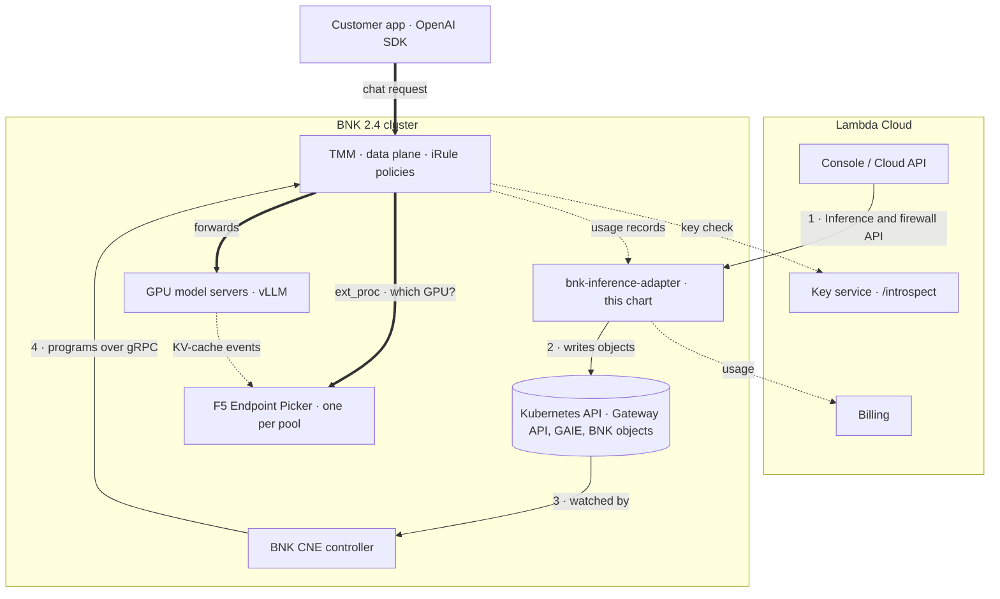
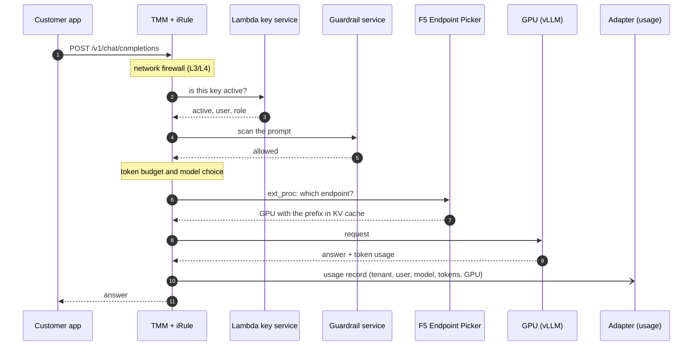
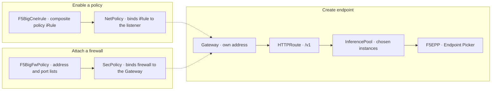
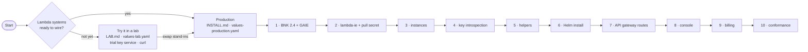

# Lambda Inference Gateway on F5 BIG-IP Next for Kubernetes: production guide

This kit takes the Inference Gateway from the Lambda Cloud POC lab into Lambda's production environment.
It has everything an engineer needs without starting the lab: the API contracts, the Helm chart, production
values, the helper services, the console integration, and a step-by-step install.

## Start here

**[Open the visual guide →](https://iracic82.github.io/lambda-bnk-production-guide/)**

The visual guide is one page with everything: architecture, contracts and envelopes, what each API call does
in BNK, who owns what, lab vs production, and the install with a copy button on every command. It's the
same file as `index.html` in this repo, which also works offline: download the repo and open it in a browser.

The install comes in two views. Pick one:

| View | For | Steps | Values |
|---|---|---|---|
| **Production** | Lambda's environment: your BNK, key service, API gateway, console and billing | [INSTALL.md](INSTALL.md) | [values-production.yaml](values-production.yaml) |
| **Try it in a lab** | A quick trial on a test BNK cluster with a trial key service, before anything is wired | [LAB.md](LAB.md) | [values-lab.yaml](values-lab.yaml) |

The lab view is the procedure that was run on the reference lab. The production view replaces every lab
stand-in with the Lambda system that takes its place.

## How it works

### Architecture: control path and request path

### One chat request

### API calls to BNK objects

### Two install paths

## What's in the kit

| Path | Contents |
|---|---|
| `index.html` | Visual guide, self-contained |
| `INSTALL.md` | Production install, step by step, with the lab vs production differences |
| `LAB.md` | Trial install on a test BNK cluster, about an hour |
| `values-production.yaml` | Production Helm values; every `CHANGE` line needs your value |
| `values-lab.yaml` | Trial Helm values |
| `chart/` | Helm chart for `bnk-inference-adapter`, the service that implements both APIs |
| `contracts/inference-gateway.openapi.yaml` | Inference Gateway API (OpenAPI 3.1) |
| `contracts/network-firewall.openapi.yaml` | Network firewall API (OpenAPI 3.1) |
| `manifests/calypso-relay.yaml` | Guardrail relay in front of F5 AI Guardrails |
| `manifests/frontier-proxy.yaml` | OpenAI-compatible proxy in front of Amazon Bedrock |
| `manifests/introspect-stub.yaml` | Trial key service that meets the introspection contract (lab only) |
| `manifests/mock-guardrail.yaml` | Keyword guardrail scanner for trying the guardrails policy (lab only) |
| `relay/` | TCP relay image that makes a model server outside the cluster a pool member |
| `frontend/` | Console integration: calls per screen, the fetch client, generated types, routing reference |
| `docs/bnk-objects.md` | The BNK and Gateway API objects behind every call |
| `docs/samples/` | Rendered objects for one endpoint, and a rendered iRule |
| `scripts/conformance.sh` | Checks any install against the contract, one PASS or FAIL per check |
| `scripts/api-walkthrough.sh` | The whole flow in `curl`: create, policies, chat, usage, benchmark, delete |
| `tools/` | Rebuilds `index.html` from the kit's files: `python3 tools/build-kit.py` |

## The integration surface

- **One Helm chart** in a `lambda-ie` namespace, plus two small helpers.
- **Two prefixes on Lambda's API gateway:** `/api/v1/inference-*` and `/api/v1/network-firewall-*`.
- **One introspection endpoint:** `POST {"token"}` returns `{"active", "sub", "role"}`.
- **Usage records** for billing, one line per request.

Both APIs follow Lambda Cloud API v1.10.0 conventions: Bearer keys, `{"data": ...}` and
`{"error": {...}}` envelopes, and `-operations` paths for actions. They drop into the existing spec.

## Requirements

- F5 BIG-IP Next for Kubernetes 2.4, licensed, with TMM running
- Gateway API CRDs and Gateway API Inference Extension v1.4.0 CRDs
- `lambda-ie` in `CNEInstance.spec.eppNamespaces`, with the F5 registry pull secret
- vLLM model servers (KV-cache events on for cache-aware routing)
- Helm 3.x, kubectl

## Versions

| Component | Version |
|---|---|
| Chart / adapter image | 0.1.0 (`iracic82/bnk-inference-adapter:0.1.0`) |
| BNK | 2.4.0 |
| GAIE | v1.4.0 |
| Benchmark engine | NVIDIA AIPerf 0.13.0 (inside the adapter image) |

License: Apache-2.0.
